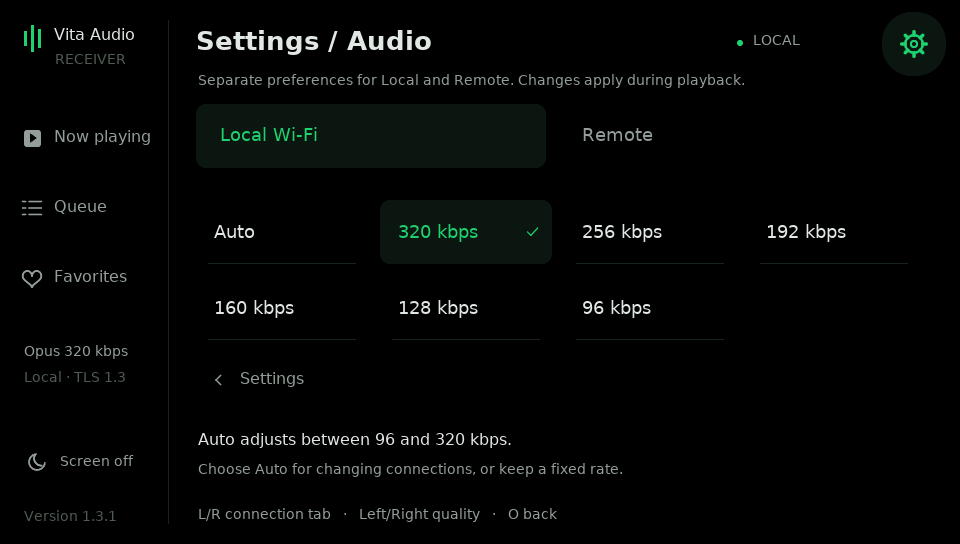

# Choose stream quality on the Vita — 1.3.1

First complete [HOST_SETUP.md](HOST_SETUP.md). While connected, or on the
connection screen:

1. Open **gear → Audio quality**, or press SELECT, choose Audio quality and X.
2. Choose **Local** or **Remote**, then a fixed **96/128/160/192/256/320 kbps**
   or **Auto**. The saved choices are independent; initial defaults are 320.
3. Circle returns to Settings; SELECT closes it. The active route's choice
   applies during playback after already buffered audio, without restarting.

Use Up/Down or L/R to select the connection tab, Left/Right or X to cycle its
rate, and Circle to return to Settings. SELECT closes the whole menu. Choices are saved
on the Vita in `ux0:data/vita-audio-receiver/quality.bin`. File writing happens
on the network/settings worker, never in the live audio output loop.

For a poor remote connection, choose **128 KBPS** for a predictable rate or
**AUTO** to let the receiver feedback control it. You can leave Local at 320.
This changes the PC-to-Vita Opus link, not Spotify Soloist's source quality.

## Fixed rates and data use

| Setting | Opus bytes/sec | Audio framing + typical TLS, MB/hour |
| --- | ---: | ---: |
| 320 kbps | 40,000 | 145.7 |
| 256 kbps | 32,000 | 116.9 |
| 192 kbps | 24,000 | 88.1 |
| 160 kbps | 20,000 | 73.7 |
| 128 kbps | 16,000 | 59.3 |
| 96 kbps | 12,000 | 44.9 |

These approximate decimal MB values assume three-frame/60 ms TLS writes and
exclude TCP/IP, Wi-Fi, receiver feedback, controls, artwork and provider encapsulation. All modes
are stereo 48 kHz, 20 ms packets, constant bitrate. Opus is lossy at every rate.
The fixed setting stays fixed even if the network gets worse.

The player sidebar shows the bitrate of the actual decoded CBR packets, including
changes during a session. An Auto stream is labeled **Auto · 128 kbps**, for example.
The initial header can still say the PC default before the first quality report.

## What Auto does

- Range: **96–320 kbps**. It starts at **192 remote / 320 local** after selecting
  Auto on a new session. Short audio resets for the same paired Vita can retain
  the last Auto rate for up to two minutes. Auto is opt-in; it never silently replaces a fixed choice.
- The Vita reports its real buffer, rebuffer counter and playback progress once
  per quarter-second over the authenticated audio connection, including decoded-frame
  acknowledgements for end-to-end pacing. Changes are also sent
  promptly when you select a new rate. The host does not estimate quality from
  the home PC's Wi-Fi link speed.
- A new rebuffer, repeated buffer levels below 80 ms, or repeated TCP send stalls
  steps the rate down. Multiple new rebuffers can drop two steps. A five-second
  hold between reductions avoids oscillating on every packet.
- It steps up only after **60 consecutive seconds** of fresh reports with a
  healthy buffer and no stall: at least 300 ms remote / 140 ms local.
- Reports delayed for over four seconds block increases. A modern stream reopens
  audio after five seconds without fresh receipt feedback; the legacy Auto path
  can continue reducing roughly every ten seconds while feedback stays stale.
- Fixed choices ignore the Auto algorithm. Changing to a fixed value applies
  that value, including raising it back to 320, when the next packets are encoded.

Remote playback buffers **1.024 seconds** before starting or recovering, versus
**256 ms** locally, within a **2.048-second** capacity. The host can send captured
backlog at up to 4x delivery speed to rebuild the receiver cushion.
This trades some response latency for tolerance of variable arrival times.
Artwork chunks are limited to about **8 KiB/sec remote**, versus 80 KiB/sec local,
so a new cover is slower to appear but competes less with audio. Metadata and
controls retain priority over cover chunks.

Auto cannot repair missing Windows capture samples, guarantee a provider rate,
or prevent interruption during a Wi-Fi disconnect. It reacts to end-to-end
receiver conditions, regardless of where the actual bottleneck lies. Long
hardware/mobile-network tests are still needed to tune the thresholds.

## Compatibility and PC settings

Use the host and Vita app from the same public release. Saved pairing remains
valid through ordinary updates. See HOST_SETUP.md for the short update steps.
