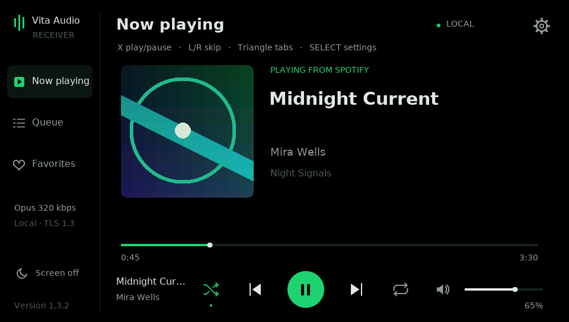
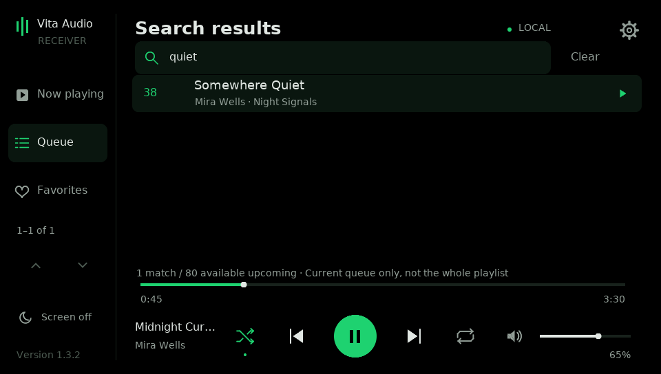

# Vita Audio Receiver

[Download the latest release](https://github.com/egalindo2167/vita-soloist-receiver/releases)
· [Setup](HOST_SETUP.md) · [Controls](UI_GUIDE.md) · [Help](SUPPORT.md)

Stream **Spotify Soloist running on your Windows PC** to a homebrew PS Vita,
with playback controls, cover art and an OLED-friendly interface. The PC does
Spotify playback; the Vita receives audio and controls the PC bridge. This is
not a standalone Spotify client for the Vita.

Unofficial community homebrew. Not affiliated with or endorsed by Spotify,
Sony, Tailscale or VB-Audio. Spotify Soloist, third-party accounts and their
terms remain separate from this project.

## Download and start

Open **[Releases](https://github.com/egalindo2167/vita-soloist-receiver/releases)**
and download the complete **vita-audio-receiver-1.3.2.zip** application asset.
Extract it before running anything. Keep the PC files and `pc/native/` together.
The release also provides a standalone VPK for updating an existing setup.

Use the named application ZIP, rather than GitHub's automatic **Source code**
archives: those do not contain the prebuilt Vita VPK. You need both the Windows
host and Vita application, not just the VPK. Each person supplies their own
Soloist download/key and generates their own Vita pairing file.

**First setup:** follow **[HOST_SETUP.md → First setup on a new PC](HOST_SETUP.md#first-setup-on-a-new-pc)**.
It walks through Python/Soloist, **Setup Host.cmd**, audio routing, VPK installation,
USB pairing and selecting **PS Vita (PC bridge)** in Spotify. For the virtual
cable, follow **[AUDIO_SETUP.md](AUDIO_SETUP.md)**. Start on the same Wi-Fi; remote
access is optional and can be added later using **[FUNNEL_SETUP.md](FUNNEL_SETUP.md)**.

**Existing installation:** close the Vita app, extract the new release ZIP, run
**pc/Upgrade Host.cmd**, then install **dist/vita-audio-receiver.vpk** over the
current app. Keep all saved data. Use the host and VPK from the same public release. Login/key, cable routing,
pairing, favorites, codec/bitrate and Funnel settings are retained; no new pairing is needed for an ordinary upgrade.

## Requirements

| Component | Requirement |
| --- | --- |
| Vita | Homebrew-enabled PS Vita and VitaShell for VPK installation/USB pairing |
| PC | Windows 11 x64, kept awake and signed in while listening |
| Python | Standard x64 CPython 3.14 with TLS-PSK; not 3.14t/free-threaded or ARM64 |
| Spotify | Your own official Windows x86_64 Soloist download and personal API key; see its current account/setup requirements |
| Audio | A separately installed virtual cable, normally VB-CABLE, dedicated to Soloist |
| Network | Working Vita Wi-Fi; same-LAN setup or optional Tailscale Funnel remote access |

Windows ARM/x64 emulation is untested. Custom Windows EXE/DLL files are currently
unsigned; see [Windows setup/security troubleshooting](docs/WINDOWS_TROUBLESHOOTING.md).

No Soloist executable, key, virtual-cable installer, Spotify account data or
provider client is redistributed. The VPK includes its decoder/TLS libraries;
no additional Vita codec plugin is required.

## Features

- Now playing, Queue and Favorites tabs; track/artist/album text and cover art.
- Play/pause, previous/next, seek, Spotify volume, shuffle and repeat.
- Search available upcoming songs by title/artists, using touch or controller.
  Five-row result pages retain queue positions. Distant selections preserve
  the existing queue/context and show cancellable confirmed-skip progress.
- Opus 96/128/160/192/256/320 kbps, separate Local/Remote preferences and opt-in
  Auto based on the Vita's reception feedback. PCM is also available.
- A persistent PC host that waits for the Vita; optional Windows sign-in startup.
- Process-only Soloist capture through a dedicated virtual output: other PC
  audio stays on your normal speakers/headphones.
- Mandatory paired TLS 1.3, per-device USB provisioning/revocation and optional
  Tailscale Funnel TCP passthrough for use from another network.
- Exact-black interface, dimming, saved screen timeout and screen-off listening.

## Important limits

The PC must stay awake and signed in. The Vita app must remain open. Its screen
can turn off while listening, but full suspend, playback over other games/apps
and offline Spotify downloads are not supported.

Search covers **Soloist's available upcoming queue**, not the entire playlist or
Spotify catalogue. Spotify documents metadata for **up to 80 upcoming tracks**;
get_queue(limit=0) requests everything available, not thousands of playlist
entries. See [SEARCH.md](SEARCH.md) for primary sources, exact controls and a
read-only check of your installed build's actual returned count.

The Opus bitrate describes this app's PC-to-Vita link, not Spotify source quality.
Opus is lossy; even a lossless Soloist source is not bit-perfect through this
capture/resample/encode path. Buffering helps delivery jitter but cannot restore
samples lost by a Windows audio driver. Full quality/network details are in
[QUALITY.md](QUALITY.md) and [NETWORK_TUNING.md](docs/NETWORK_TUNING.md).

Soloist is a separate upstream dependency; its builds/account requirements and
API can change. Update an expired official build as needed. This app does not
bypass Spotify authentication, DRM or account restrictions. It is a community
project, not an independently audited public internet service.

## Documentation and support

| Guide | Contents |
| --- | --- |
| [HOST_SETUP.md](HOST_SETUP.md) | Fresh setup, upgrade, pairing, host startup and firewall |
| [AUDIO_SETUP.md](AUDIO_SETUP.md) | Dedicated virtual cable and Soloist process capture |
| [UI_GUIDE.md](UI_GUIDE.md) | Vita buttons, touch controls, settings and OLED behavior |
| [FUNNEL_SETUP.md](FUNNEL_SETUP.md) | Optional remote access without a Vita VPN client |
| [SEARCH.md](SEARCH.md) / [FAVORITES.md](FAVORITES.md) | Queue search and local song/playlist shortcuts |
| [SUPPORT.md](SUPPORT.md) | Troubleshooting, logs and bug reports |
| [Full reference](docs/REFERENCE.md) | Full reference, bandwidth, controls and technical limits |
| [SECURITY.md](SECURITY.md) | Trust boundaries and private vulnerability reporting |
| [BUILDING.md](docs/dev/BUILDING.md) / [CONTRIBUTING.md](CONTRIBUTING.md) | Source builds, generated native payloads and contributions |
| [CHANGELOG.md](CHANGELOG.md) | Version history |

Use **Issues** for reproducible bugs and feature requests. Inspect/redact logs
before uploading them; never post API/provider keys, pairing files or account
data. Report vulnerabilities privately using the instructions in SECURITY.md.

## License and credits

Project-authored code uses the [MIT license](LICENSE). Third-party components
retain their own licenses; see [THIRD_PARTY_NOTICES.md](THIRD_PARTY_NOTICES.md)
and [SUPPLY_CHAIN.md](docs/dev/SUPPLY_CHAIN.md) for sources, attribution and exact pins.
Original LiveArea art is in `assets/`; the UI raster font includes its license.
Spotify Soloist and third-party drivers/providers are obtained independently.

Maintainers: release assets come from the tagged CI build, with source-commit
and run metadata. Review the CI-created draft before publishing.

Maintainers: [publication checklist](docs/dev/PUBLISHING.md) and
[checks performed / hardware limits](docs/dev/BUILD_VALIDATION.md).

Source checkouts do not include generated Windows binaries or their loader-hash
module. Download the complete application asset for installation, or follow
[the source build instructions](docs/dev/BUILDING.md). A source ZIP is not an
installable release. For this prerelease, use the release list above.
