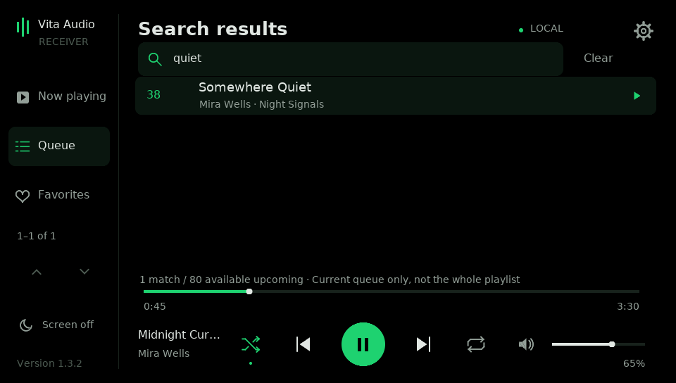
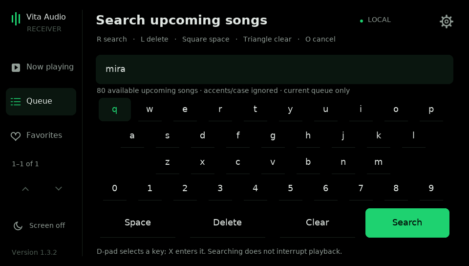

# Search upcoming songs — version 1.3.2

## What Soloist actually exposes

The implementation was checked against Spotify's documentation on 2026-11-08:

| Source | Finding |
| --- | --- |
| [Spotify's Soloist announcement](https://developer.spotify.com/blog/2026-08-13-introducing-spotify-soloist) | Queue metadata for up to **80 upcoming tracks**. |
| [WebSocket API: get_queue](https://developer.spotify.com/documentation/soloist/reference/websocket-api) | Omitting limit or specifying 0 returns all **available** entries. Automatic queue_changed broadcasts include at most 10 per list. |
| Same API's command reference | No documented offset/cursor for retrieving a playlist beyond that window, playlist-content endpoint or direct jump-to-queue-entry command. |

Consequently, requesting a high limit does not promise the whole playlist.
A playlist of 3,000 songs may expose only its next 80 songs. This app requests
`get_queue(limit=0)`, uses everything returned within its safety bounds, and
shows the actual searchable count. It does not hard-code 80 or manufacture
entries beyond Soloist's reply. Shorter lists, unavailable entries and different
Soloist builds can produce different counts.

The old app's 32-song limit was our display/message limit. That limit is removed
for 1.3.2 clients: five rows are sent at a time, with search/indexing on the PC.
Old receivers keep their legacy 32-row messages. Favorites still support 32
shortcuts; this release does not change favorites editing.

No live Spotify account/session was available in the build environment. The
documentation establishes the supported window; the read-only helper below can
measure what your installed Soloist build actually returns.

## Update and use

1. Close the Vita app. Extract the complete 1.3.2 ZIP and run **pc/Upgrade Host.cmd**.
   Keep your current Soloist login/key, cable routing, pairing and Funnel profile.
2. Install **dist/vita-audio-receiver.vpk** over the existing Vita app. Keep its
   saved data. Update both ends for search; no new pairing is required.
3. Open the Vita app and play your playlist on **PS Vita (PC bridge)**. Open
   **Queue** from the sidebar or Triangle from Now playing.
4. Tap the search bar or press **Square**. Enter a title, artist, or several
   words. Every word must occur somewhere in the combined title/artists; order
   does not matter. Case and accents are ignored, so `beyonce` matches `Beyoncé`.
5. Tap **Search** or press **R**. Entering text itself sends no queue requests;
   submitting filters the host's current queue cache without changing playback.
6. Use Up/Down to select and cross page boundaries, or the sidebar arrows to
   page by touch. The list shows five matches at a time and their original
   upcoming queue positions. The sidebar range counts filtered matches.
7. Tap a row or press X to play it. Tap **Clear** beside the search bar to remove
   the filter. With no filter, that button becomes **Refresh**. Circle returns
   to Now playing; reopening Queue retains the session's query.

### Keyboard controls

| Input | Action |
| --- | --- |
| Touch a key | Enter its letter/digit, or use the bottom editing actions |
| D-pad, then X | Select a key, then enter it |
| R | Submit search |
| L | Delete the last character |
| Square | Space |
| Triangle | Clear the draft |
| Circle | Cancel editing, retaining the previous search |

The keyboard uses Latin letters, digits and spaces. It is an app keyboard,
not Sony's full-language input system. Some non-Latin characters are not
rendered by the bundled font. Accent folding on the host works without typing
the accented character. Search text is limited to 127 UTF-8 bytes.




While viewing results, the normal playback bar and **L/R previous/next** still
work. While the keyboard is open, L/R instead delete/submit as listed above.
The results update as the available queue changes and are cleared when its
context or Soloist API session is lost. The queue is refreshed periodically;
newly available songs can appear as playback progresses. Repeating/shuffling a
playlist changes the upcoming window, not the search's scope.

## Playing a result without replacing the queue

Soloist has no documented command to jump directly to a queued entry. The host
therefore resolves the result's opaque token against the current queue and
sends one Next at a time, waiting for current-song and queue confirmation.
It never falls back to `play(uri)`, which would replace the playback context.

Selections over eight skips away show confirmation first. Once started, a
progress screen shows confirmed skips. X, Circle or the touch Cancel stops
future skips; a command already dispatched may finish. Skips already completed
cannot be undone. These are real Spotify skip commands: depending on upstream
account rules, long jumps may consume skip allowances and may affect recent
activity/history. The app does not guarantee how Spotify records skipped songs.
Account restrictions can interrupt a jump; use Spotify on a phone/PC for distant
selections when that matters. Audio is held during the jump so intermediate songs are not
played to the Vita, then starts from the resulting song with a fresh buffer.

The host rejects targets over 256 skips away before sending anything, allows
at most six seconds for each confirmation, and bounds the whole jump to
20–120 seconds depending on distance. It stops on a changed context, stale or
ambiguous token, duplicate tracks without stable entry IDs, error or timeout.
The currently reached song remains selected if a jump stops partway through.
Very distant songs should be selected in Spotify on the phone/PC.

These safeguards matter if a future build exposes more than the documented
80-track window. Searching can cover a larger returned list without promising
that thousands of sequential skips would be practical or safe.

## Check your actual Soloist build's queue window

1. Keep the Windows host running. In Spotify, play a large playlist and select
   **PS Vita (PC bridge)** as the playback device. Start near its beginning.
2. Open **pc/Queue Availability.cmd** from the release, or from a terminal in pc:

```powershell
py -3.14 queue_probe.py
```

3. It sends one read-only `get_queue(limit=0)` and watches replies for three
   seconds, reporting the largest upcoming count. This avoids mistaking an
   automatic 10-item broadcast for the full requested snapshot. It does not
   change playback, rebuild the queue, save track metadata or use a new key.
4. Repeat with another playlist or after a Soloist update if needed. The reported
   count is the current available queue window, never proof of playlist length.

If the count is around 80 for a much larger playlist, the upstream window is the
limit. A lower count near the end of a playlist is normal. If the helper returns
more, the app can search it within the bounds below. A paired Vita is not needed
for this local diagnostic; the running, signed-in Soloist session is.

## Resource limits and verification

The PC indexes at most **10,000 returned entries** and accepts Soloist events up
to **16 MiB**. These are application safety bounds, not claims that Soloist will
return that many songs. A truncated list is explicitly labelled on the Vita.
Queries/results remain in session memory; no extra listening port or Spotify
Web API login was added. Result pages are at most 2,096 payload bytes and retain
the existing authenticated encrypted control channel. Search sends no artwork
for individual result rows and does not change audio bitrate or buffering.

Automated tests exercised a real local WebSocket/paired TLS fixture with 5,000
**synthetic** entries, 79 confirmed skips with context/following-song retention,
cancellation, normalization, paging and stale/malformed replies. Those results
verify the app's own limits and transport, not Spotify returning 5,000 tracks.
Physical Vita touch/keyboard behavior and a live Soloist account still need
checking on your setup. See [build verification](docs/dev/BUILD_VALIDATION.md) and [test notes](tests/README.md).

Full large-playlist browsing/search would need another source, such as Spotify
Web API playlist access with its own authorization and availability constraints.
That is a separate feature; silently skipping through a playlist to scrape it
would disturb playback and is not done here.
