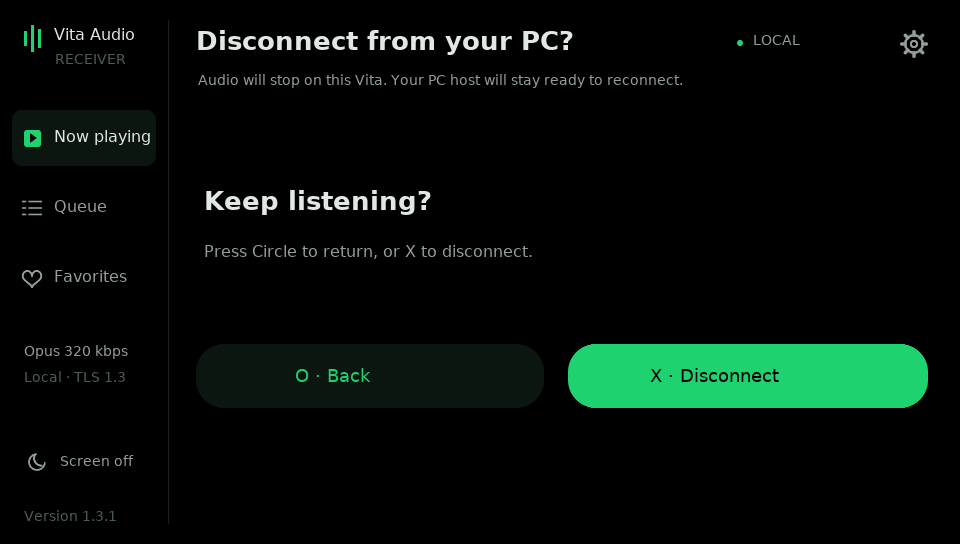
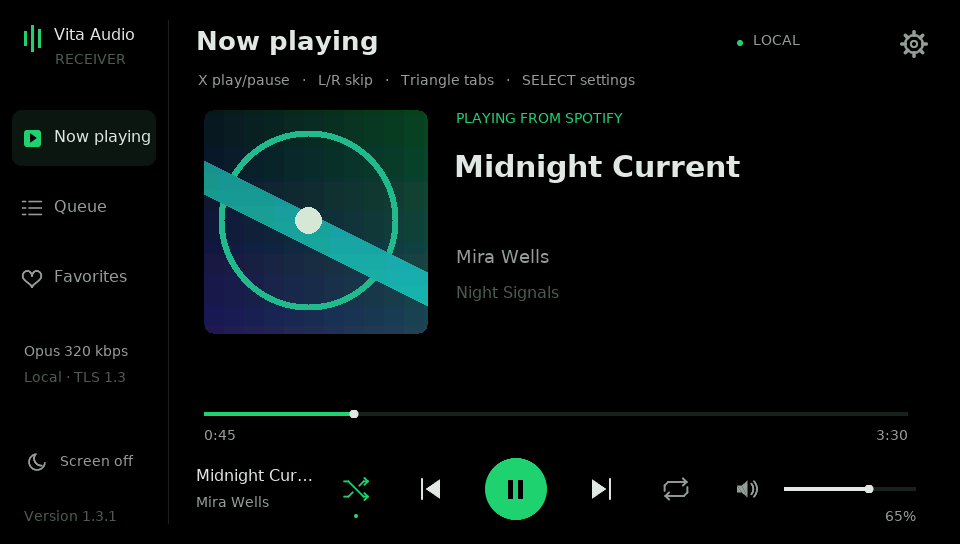
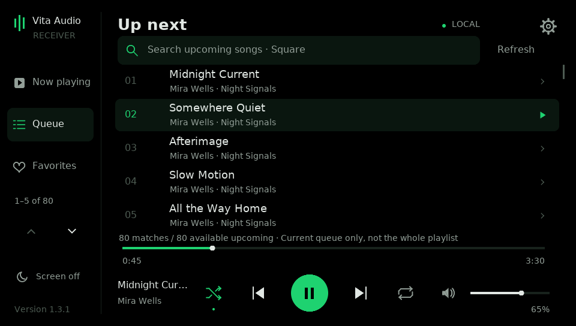
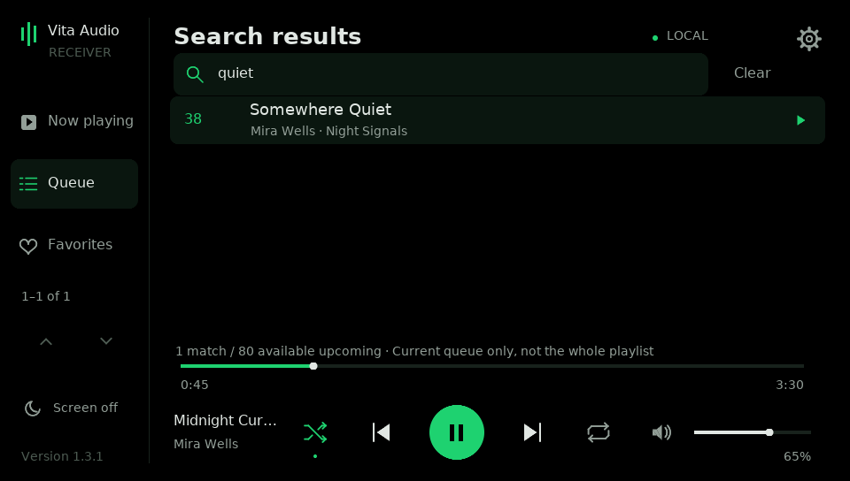
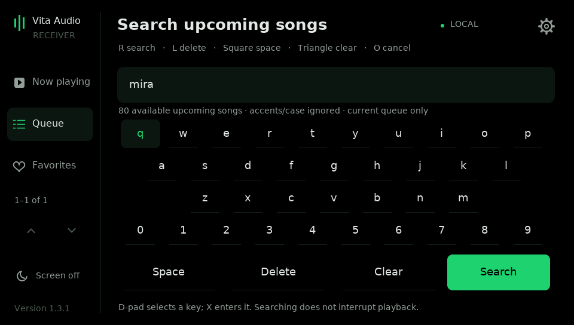
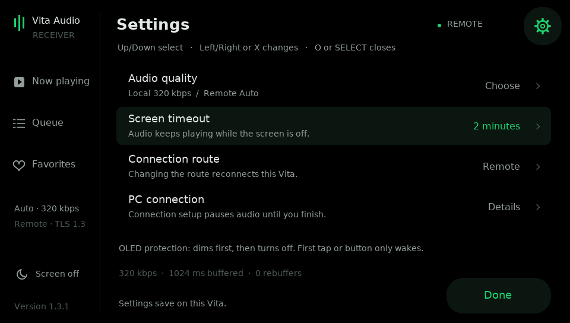

# Vita interface — version 1.3.1

## First use

Complete [HOST_SETUP.md](HOST_SETUP.md), install the release VPK and open it
once to create its data folder before USB pairing. Start on your trusted home
Wi-Fi. The PC host stays running; open the Vita app to connect and choose music.

## Playback and navigation

The left sidebar has **Now playing**, **Queue** and **Favorites**. Touch a tab,
or use Triangle to cycle through all three. The playback bar stays available in
both browsing tabs. Shuffle and repeat turn green when enabled; repeat-one also
shows “1”. The main play control displays a triangle when paused and two bars
when playing. A tap in the larger surrounding target activates the same control.

| Input | Now playing | Queue / Favorites |
| --- | --- | --- |
| X | Play/pause | Play the selected item |
| L / R | Previous/next track | Previous/next track; keep the browser open |
| Up / Down | Seek forward/back ten seconds | Select a row; pages follow selection |
| Left / Right | Spotify volume −5/+5 | Switch Queue / Favorites |
| Triangle | Queue | Next tab, returning to Now playing after Favorites |
| Square | Toggle shuffle | Queue: search; Favorites: shuffle |
| SELECT | Open Settings | Open Settings |
| Circle | Ask before disconnecting | Return to Now playing |
| START | Exit | Exit |

Circle from Now playing opens a confirmation. **X / Disconnect** stops the
connection; **Circle / Back** keeps listening. Circle in a browser/settings/
keyboard retains its ordinary back/cancel action. Offline Circle cancels the
pending connection. START still exits.

Touch the progress bar to seek. Its hit area extends above/below the thin line.
Drag the Spotify volume slider; tapping the speaker icon mutes/restores its
previous nonzero level. Vita hardware volume remains an independent local volume.
Tap shuffle/repeat to toggle/cycle them. Touch rows have their full 56-pixel
height available; the sidebar up/down arrows page five items at a time.

Selecting a Queue item still advances through the existing queue with confirmed
skips, preserving its following songs/context. Several skips can take a moment.
Selecting a Favorite intentionally starts its song/album/playlist context.
See FAVORITES.md for adding playlists/songs on the PC. This release does not add
new favorite editing or Spotify-library features.

## Search upcoming songs

Open Queue, then tap its search bar or press **Square**. Use the touch keyboard,
or select a key with the D-pad and enter it with X. **R searches, L deletes,
Square adds a space, Triangle clears and Circle cancels.** The equivalent touch
actions are along the bottom. Search matches words in the title and artists,
ignoring case/accents; it does not interrupt playback. The bundled keyboard has
Latin letters, digits and spaces, not a full system-language IME.

Results retain their original upcoming queue positions. Up/Down selects across
five-row pages; the sidebar arrows page by touch. Tap a result or press X to
play it. L/R still skips while viewing results. Tap Clear to remove the filter.
The screen shows matches and available upcoming count, not the playlist length.
Spotify documents up to 80 upcoming tracks; a large playlist is not fully
searchable through Soloist alone. See **[SEARCH.md](SEARCH.md)**.

More than eight skips asks for confirmation. X/Continue starts, Circle/Back
cancels before starting. While advancing, X, Circle or Cancel stops subsequent
skips; one already dispatched can still finish. The existing queue/context is
preserved, and the audio stays held until the jump finishes or is cancelled.

## Gear menu

Tap the top-right gear or press SELECT. Use Up/Down to choose a row, X to open/
change it, or Left/Right to change its value. Tap a whole row to activate it.
Circle returns from Audio quality to Settings, then closes Settings. SELECT,
the gear or Done closes the menu; a held menu touch cannot activate playback
after it closes. The sidebar can return directly to a music tab.

- **Audio quality:** choose the Local or Remote preference, then Auto or a fixed
  96/128/160/192/256/320 kbps. L/R or Up/Down changes connection tab; Left/Right
  or X cycles the quality. Settings back arrow/Circle returns. See QUALITY.md.
- **Screen timeout:** cycles 30 seconds, 1 minute, 2 minutes, 5 minutes and Never.
  Default is 1 minute. This is saved separately in display.bin.
- **Connection route:** Local Wi-Fi or Remote. Changing it reconnects the Vita.
  Existing saved PC/Funnel settings are retained.
- **PC connection:** opens the existing address editor or remote-endpoint view.
  Audio pauses until you finish this connection setup. X saves/connects;
  Circle backs out. In the local editor, Left/Right selects an octet, Up/Down
  changes it by one, L/R by ten; Triangle restores automatic discovery.

The menu also shows the received bitrate, current buffer and rebuffer count.
Editing Local's quality while connected remotely does not change the Remote
preference. Changes to the current route apply during playback without a restart.

## OLED and screen-off listening

The interface background remains exact black. It dims the whole frame, including
artwork, after 30 seconds without input, or 15 seconds with the 30-second timeout.
After the chosen timeout it presents a completely black frame and requests panel
off. Audio/network processing continues. With Never, automatic dimming remains,
but automatic screen off is disabled. **Screen off** in the left sidebar always
works immediately, including from Settings.

The first tap/button after screen off only wakes the display. Release it before
operating music controls. If the firmware intercepts those inputs while the
panel is off, briefly use the power button, then wake the UI with a face button.
New music/artwork/progress does not reset the idle timer. Full suspend, leaving
the app or launching a game still interrupts playback. See README.md for limits.

The screenshots are generated with this release's actual renderer and original
fictional music/artwork fixtures. Physical touch/panel behavior needs checking
on a Vita; desktop previews are not hardware measurements.

## Updating to a newer release

Install the new VPK over the existing title and run Upgrade Host from the full
new release ZIP. Keep saved data; normal updates need no new pairing or login.
See HOST_SETUP.md for the short upgrade procedure.
