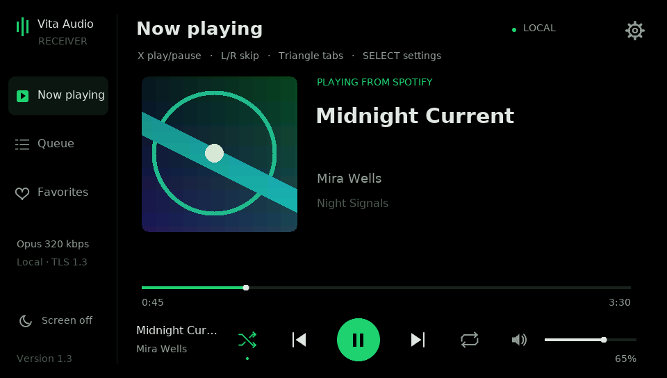
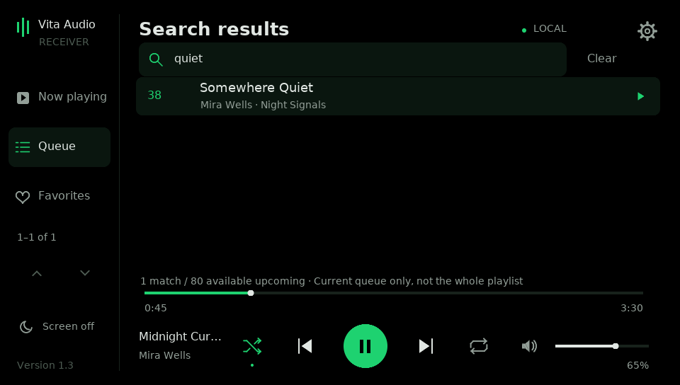
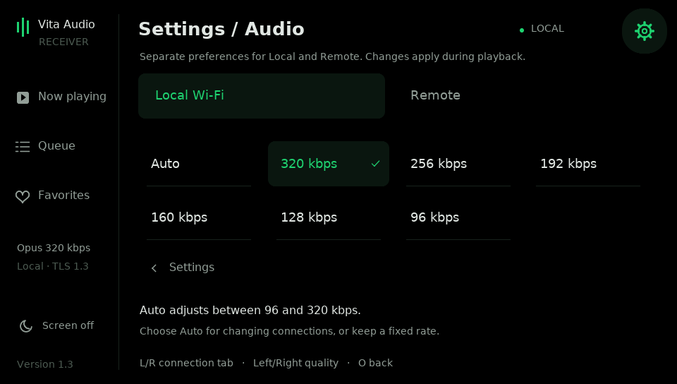
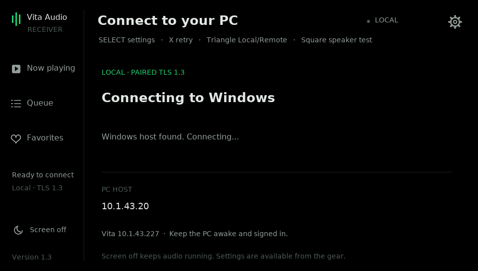

# Vita Audio Receiver user guide — 1.3

Stream only Spotify Soloist's audio to a homebrew PS Vita, with Spotify
controls, browsing, titles and cover art. The Vita initiates paired TLS 1.3
connections. Local Wi-Fi and optional Tailscale Funnel remote access are supported.

**Requires:** a homebrew Vita, a Windows 11 x64 PC kept awake/signed in, Python 3.14, a virtual cable,
and your own official Soloist download/key. First-time setup:
**[HOST_SETUP.md](HOST_SETUP.md)**. Remote setup:
**[FUNNEL_SETUP.md](FUNNEL_SETUP.md)**. Nothing needs installing on Vita for VPN.

## Upcoming-song search and upgrade

Version 1.3 adds **Search upcoming songs** to Queue, with a touch/controller
keyboard, title/artist matching and five-row result pages. It requests all
available Soloist queue entries instead of imposing the old 32-song display cap.
Spotify documents metadata for **up to 80 upcoming tracks**; this is a current
queue window, not a full large playlist. The screen shows the actual searchable
count. See **[SEARCH.md](SEARCH.md)** for the investigation, controls and limits.
**[UI_GUIDE.md](UI_GUIDE.md)** covers the complete interface.



For an existing working installation, **update both the Windows host and VPK**:

1. Close the Vita app, extract the complete **1.3 ZIP**, and run **pc/Upgrade Host.cmd**.
   Keep pc/native with the scripts. Your existing cable choice, Soloist key/login,
   favorites, startup shortcut, pairing and Funnel profile are preserved.
2. Install **dist/vita-audio-receiver.vpk** over the current app. Keep the Vita's
   data directory, private pairing file, Remote profile and quality settings.
3. Open the Vita app in the same Local/Remote mode as before. There is no new
   Spotify login, transport pairing or Funnel setup to repeat.
4. Open **Queue**, tap its search bar or press **Square**, enter words and tap
   **Search** or press **R**. Use **Clear** to return to all available upcoming songs.



Keep the saved data when installing. The old host still connects but cannot
provide the new paged search; the Vita asks you to upgrade it. Old Vita clients
remain compatible with the new host's legacy 32-row queue messages.

Remote now has **2.048 s capacity / 1.024 s prebuffer**, with bounded receiver-driven
catch-up after stalls. Audio writes batch three unchanged Opus frames (60 ms).
Up Next selection advances the existing queue instead of starting a new context;
skip/seek reset only the audio stream to discard old app/kernel/tunnel buffers.
Read **[NETWORK_TUNING.md](NETWORK_TUNING.md)** and the supplied-review assessment
in **[REVIEW_1.1.md](REVIEW_1.1.md)** for tradeoffs and precise limits.

For first setup, install VB-CABLE and follow **[AUDIO_SETUP.md](AUDIO_SETUP.md)**.
Keep only Soloist routed to the saved cable and leave normal Windows audio on
its preferred physical output. The managed stream still captures only the owned
Soloist process tree; a missing cable/wrong route never falls back to speakers.

Visible version: **1.3**. Internal Vita APP_VER advances to **01.17** for monotonic
installation after the earlier 01.15/01.14 tags. Title ID and saved-data paths
are unchanged. Fixed 96/128/160/192/256/320 kbps and opt-in Auto remain available.

Read **[QUALITY.md](QUALITY.md)** for controls and Auto behavior. Auto uses the
Vita's actual buffer/rebuffer feedback, starts at 192 remote / 320 local, lowers
when reception stalls and raises one step after 60 healthy seconds. The player
shows the actual received CBR rate. It cannot repair Windows capture gaps or a
complete Wi-Fi outage.



Current security and remaining trust boundaries are in **[SECURITY.md](SECURITY.md)**.
Build/dependency pins are in **[SUPPLY_CHAIN.md](SUPPLY_CHAIN.md)**. Historical
security changes are recorded in [CHANGELOG.md](CHANGELOG.md).

## Audio quality and bandwidth

| Link format | Audio payload bitrate | Bytes per audio second |
| --- | ---: | ---: |
| Existing PCM: 48 kHz, stereo, 16-bit | 1,536 kbps | 192,000 |
| Opus 320 kbps CBR | 320 kbps | 40,000 |
| Opus 128 kbps CBR | 128 kbps | 16,000 |
| Opus plus this app's 2-byte packet lengths | 320.8 kbps | 40,100 |

TLS, TCP/IP, Wi-Fi and artwork/control traffic add overhead. TLS 1.3 adds
about 22 bytes per record with these ciphers (roughly 367 B/sec for one
record per three-frame/60 ms batch). Startup has one 16-byte
header. At the default bitrate, a 20 ms Opus packet has 800 codec bytes, plus a
2-byte length. Tests measure 40,100 B/sec before network headers, about 79.1%
less than the PCM stream. This changes the local PC-to-Vita link, not Spotify's
internet download rate. CBR keeps the audio bitrate steady even during silence.

**320 kbps Opus is lossy.** The number is not a promise of equivalence to MP3,
AAC or Spotify's other 320 kbps formats. Encoding an already lossy source again
can add loss. Soloist can support Premium lossless up to 24-bit/44.1 kHz, but our
launcher does not force that quality or verify what each song uses. In Spotify,
select PS Vita (PC bridge), open its device picker/settings and look for Change
quality settings. Choose the source quality there. The documented Soloist CLI
and local WebSocket API do not expose a quality selector for this app to use.

The bridge captures only Soloist's process tree at 48 kHz stereo/16-bit PCM,
applies the existing gain (0.5), then encodes the local Opus link. The virtual
cable keeps Soloist off physical outputs; the OS process filter excludes other
apps. Even with Soloist playing lossless, this resampled/quantized path is not a
bit-perfect copy of Spotify's original. Keeping the PCM link avoids another
lossy encode, but does not undo the Windows capture/conversion steps.

## PC codec/default and Vita quality

- **pc/Use PCM.cmd** returns to the original 192,000 B/sec PCM link.
- **pc/Use Opus 320.cmd** selects the Opus codec and its PC default. Receiver
  1.3 then applies its own saved Local/Remote preference. Use Settings → Audio quality on the
  Vita to choose the effective rate without restarting playback.
- Other Opus bitrates are available from a `pc` PowerShell window:
  `py -3.14 host.py --audio-codec opus --bitrate 256`. Choices: 96, 128, 160, 192, 256,
  320 kbps. This is the local link bitrate, not a Spotify quality setting.

The host log prints quality changes and the average bytes per audio second for a finished
session. Host Status shows the configured codec; the Vita footer shows the
negotiated session. The old unencrypted network launchers are retired; the explicitly selected endpoint diagnostic `send_audio.py --capture-only --device "EXACT ID"` and the Vita speaker test remain available for diagnosis. For a first-time setup, see HOST_SETUP.md.

The decoder is statically linked into the VPK: no Vita plugin or codec-file
installation is required. On Windows, the DLL is built from pinned upstream Opus 1.6.1 and ships in
pc/native. The loader verifies its hash; no third-party Opus wheel is used.

## Screen-off listening and OLED mode

- By default, after **30 seconds without input**, the entire UI, including album artwork,
  dims to one quarter of its rendered color levels. System brightness is unchanged.
- By default, after **60 seconds without input**, the app presents a completely black frame,
  then requests hardware display-off. Audio/network processing keeps running.
- Tap **Screen off** at the bottom of the left sidebar to do this immediately.
- The gear → **Screen timeout** offers 30 seconds, 1/2/5 minutes or Never.
  Dimming occurs after 30 seconds (15 seconds with the 30-second timeout).
  Never disables automatic screen off; dimming/manual screen off stay available.
- The first tap or face-button gesture wakes the UI without a Spotify action.
  Its held touch/button stays suppressed until release, so a wake gesture cannot
  also pause, seek, skip or exit. Then use controls normally.
- Firmware can intercept controls while the actual panel is off. If the app
  cannot see your touch/button, briefly use the power button to wake the panel,
  then tap or press a face button once to restore the UI.

Only real touch/button interaction resets the timer. New songs, changing
artwork, advancing progress and PC metadata do not keep the display lit. A dim
screen accepts an ordinary control action directly; a black screen first wakes.
The idle screen has no lit clock, logo, track title or status text.

Screen-off is separate from full system suspend. This build cancels the
automatic-suspend timer while connected, allows the panel-off path, and marks
wireless use during the app session. It does not request system sleep. Full
suspend, leaving the app in LiveArea or launching another game still cannot be
used for continuous playback. Use the app's screen-off button/idle mode for
listening, and keep the PC awake and signed in.

If firmware rejects or ignores display-off, the displayed frame remains fully
black as a fallback. This reduces OLED static-image exposure, but is not a
guarantee against image retention. Foreground artwork and controls still light
pixels until dimming/blanking. Use a comfortable system brightness.


Native tests cover idle timing, wake gesture suppression, black-before-off
ordering, no framebuffer flips while blank, wake/repaint and a failed-off
fallback. The VPK cross-compiles, and its icon/LiveArea assets are verified inside
the package. Actual panel-off, Wi-Fi/audio continuity, wake behavior and shell
icon caching still require checking on a physical Vita; host stubs cannot prove
these firmware behaviors.

## PC host and existing features

Windows runs a persistent audio/Soloist host. Open the Vita app to discover the
PC, initiate the audio/control connections and resume the paired Soloist device.
After the one-time setup there is no PC address, terminal command or key prompt
for each session. The Windows host stays running when the Vita disconnects.

Start with **[HOST_SETUP.md](HOST_SETUP.md)**. Install the new VPK and PC files.
Use the persistent host and one-time device pairing.



## What changed

- Background PC host, installed in `%LOCALAPPDATA%\VitaAudioReceiver\app`.
  Optional current-user sign-in startup is installed by Setup Host. Enabled remote
  tunnels start with that same host.
- Personal Soloist API key is stored with Windows DPAPI protection for the
  current Windows account, outside the distributed app files. Pairing data stays
  in the existing Soloist data directory.
- The Vita discovers the host over the local network and initiates both TCP
  connections. Settings → PC connection opens a saved PC IPv4 editor if
  discovery is blocked. X retries; Circle cancels/reconnect waits until X.
- PC capture starts only after paired TLS/role authentication. Audio becomes available after the native helper checks the process/device and starts successfully.
  Disconnects return to the listener; capture/device failures do not require
  re-entering the key or restarting the whole application.
- Windows capture warnings print only when the cumulative count increases.
  The old repeated `1 discontinuities` message was one report being repeated,
  not proof of new gaps every few seconds.
- Capture workers request Windows MMCSS audio scheduling when available.
- PC audio uses bounded receiver-driven pacing and 60 ms writes. Vita capacity
  is 2.048 seconds; Remote startup is 1.024 seconds and Local is 256 ms.
- Cover images use small, paced chunks, yielding to playback metadata and
  commands. A large cover is no longer sent as one immediate Wi-Fi burst.
- Receiver rebuffer counts are logged separately from Windows capture gaps.
- Existing gain (0.5), 48 kHz stereo 16-bit capture/output
  and alternating audio-output buffer lifetime remain unchanged. Only the local
  audio transport can now be Opus-compressed.

More buffering adds startup/playback delay. The configured PC/Vita startup
cushions total about 384 ms locally and 1.15 seconds remotely; device/network buffering adds to this. It can absorb
short delivery delays; it cannot reconstruct
samples actually lost by the Windows audio driver. A capture-gap counter alone
does not establish the cause of every audible hitch.

## First setup

Use [HOST_SETUP.md](HOST_SETUP.md). It covers the official Soloist download,
Python dependencies, saved API key, sign-in startup, USB pairing and firewall.
Use [AUDIO_SETUP.md](AUDIO_SETUP.md) for the dedicated cable and Soloist routing.

## Normal use

Open **Vita Audio Receiver** on the Vita. It connects automatically and resumes
the paired Soloist device. Use X/play controls once connected. For the first
Spotify pairing only, select **PS Vita (PC bridge)** in Spotify on a phone/PC.
A stored Connect session is restored on subsequent starts.

Closing the Vita app disconnects its audio. The PC host keeps waiting. Following
control disconnect, Soloist pauses/deactivates after a short grace period if it
is still the active device. A quick reconnect does not deliberately pause it.
The program cannot wake a sleeping or powered-off PC.

If discovery does not find the PC, open **Host Status.cmd** on Windows and use
its PC IPv4 address. On the Vita open the gear → PC connection, edit the address,
then X saves/connects. Left/Right selects an octet, Up/Down changes by one,
L/R changes by ten, and Triangle restores automatic discovery.

## Spotify controls

| Input | Action |
| --- | --- |
| X | Player: play/pause; Queue/Favorites: play selected item |
| L / R | Previous/next, including in Queue and Favorites |
| Left / Right | Player: Spotify volume −5/+5; browser: switch Queue/Favorites |
| Up / Down | Player: seek forward/back 10 seconds; browser: move selection |
| Square | Queue: open search; Player/Favorites: shuffle |
| Select | Open/close Settings (also available from the gear) |
| Triangle | Cycle Now playing → Queue → Favorites → Now playing |
| Circle | Back from browser, otherwise disconnect/cancel |
| Start | Exit |
| Vita volume buttons | Local speaker/headphone volume |

Touch the playback icons, volume slider or progress bar. The repeat icon cycles
off/all/one; its green dot indicates an active mode and “1” means one track.
The speaker icon mutes/restores Spotify's volume. In the browser, Up/Down selects,
X plays, Left/Right switches tabs and Circle returns. L/R always skips tracks.
Sidebar arrows page longer lists; row targets are 56 pixels tall. Titles,
artist/album names, artwork and positions come from Soloist. Some non-Latin
characters cannot be shown by the bundled bitmap font.

Queue search covers all available entries returned by Soloist, with five rows
on the Vita at a time; Spotify documents a window of up to 80 upcoming tracks.
Up to 32 favorite shortcuts remain supported. Full-playlist/catalogue search,
library browsing and playlist editing still use Spotify on a phone/PC.
Playing an Up Next entry advances the existing queue with confirmed skips,
preserving its context and following items. Selections more than eight skips
away ask for confirmation and show cancellable progress; very distant jumps
have safety/time limits. See SEARCH.md. Outside the search keyboard, L/R skips
normally, including while viewing search results.
Favorite shortcuts intentionally start the selected URI/context.

## Favorites

Follow **[FAVORITES.md](FAVORITES.md)** for step-by-step adding, listing and removing
shortcuts, where the file is stored, and how to open the Favorites tab on Vita.
The current PC command workflow is unchanged. New Vita favorite-editing controls
are not included in this release.

## PC management and logs

The installed app folder is `%LOCALAPPDATA%\VitaAudioReceiver\app`.
Double-click **Host Status.cmd**, **Stop Host.cmd** or **Start Host.cmd** there
or in the download. The host is a signed-in user application, not a Windows
system service. It uses your normal audio session and starts when you sign in.
To remove automatic startup: `py -3.14 host.py --remove-startup`. That removes only
this app's shortcut; use Stop Host to stop the currently running instance.

Host log: `%LOCALAPPDATA%\VitaAudioReceiver\host.log` (rotated). It contains
separate Soloist, Audio and Controls messages, including Windows capture-gap
counts and Vita rebuffer counts. The key is filtered from child output.
Vita log: `ux0:data/vita-audio-receiver/log.txt`, replaced on every app launch.
Copy it after a problem and before reopening.

## Networks and limitations

Audio/control connections require a paired TLS 1.3 session. Soloist's local
WebSocket remains bound to 127.0.0.1. PC ports are TCP **48152** audio, TCP
**48153** controls, UDP **48154** authenticated local discovery. The tunnel option
forwards only the two TCP services through its own assigned public ports. The Vita exposes no
legacy audio/control listeners. Capture starts after authenticated audio startup.

Keep firewall access limited to trusted Private/VPN interfaces and peers. For
remote access use the managed TCP tunnel option in TUNNEL_SETUP.md, or a personal
VPN gateway; direct public router forwarding is not recommended. This build is not an independently audited internet service.
Client isolation may still prevent direct connections; a manual PC IP bypasses
broadcast discovery, but retains TLS authentication. See SECURITY.md.

The PC must stay awake and signed in. The Vita app must remain open. Screen-off listening is supported; full suspend, in-game/background and offline Spotify
playback remain unsupported. Only the owned Soloist process tree is captured. Keep its Windows output routed
to the saved virtual cable. A physical default-output change does not select a
new capture source. Run Setup Audio after reinstalling a cable or changing
Soloist's route; an audio-helper failure is retried automatically.

Soloist builds still expire after 90 days from build date. Replace its official
executable as necessary, then rerun Setup Host or restart the host. Native Soloist
account/key errors require fixing that setup; this app cannot bypass them.

## Diagnostics and verification

The Vita's Square button plays a local speaker test while disconnected. On PC:

```powershell
py -3.14 audio_config.py --status
# Optional whole-endpoint diagnostic (NOT process-only):
py -3.14 send_audio.py --list-devices
py -3.14 send_audio.py --capture-only capture-only.wav --device "EXACT OUTPUT ID" --seconds 15 --gain 0.5
```

The separate endpoint diagnostic never connects to the Vita. It can include all apps on the explicitly selected endpoint; the managed stream uses process capture instead. Old network sender/launcher commands
exit with migration instructions and cannot open plaintext sessions.

The VPK cross-compiles with VitaSDK. Automated checks exercise actual TLS 1.3
sessions between Python/OpenSSL and the receiver's Mbed TLS client built on the
host, audio encode/decode, reconnect, control commands through a fake Soloist
WebSocket, revocation, invalid keys, downgrade rejection, bounded discovery and
replay/nonce checks. Native tests also cover public profile validation, Local/Remote socket handover,
Opus parsing, UI startup cleanup,
true black/dimming, wake policy, control bounds and audio-buffer lifetime.

This is a Linux build/test environment. Windows DPAPI/startup/MMCSS are checked
with mocks. Windows hardware capture, firmware TLS/RNG operation and simultaneous
streaming/panel-off still need checking on your PC and physical Vita. Passing
these checks is not a professional security audit. See [tests/README.md](tests/README.md).

The original LiveArea mark is editable in `assets/mark.svg`; rebuild the checked-in
PNG assets with `python assets/build_assets.py` (Pillow and DejaVu Sans required
only by that optional developer command). Images are indexed RGB PNG in Vita
dimensions. They do not require any new Vita libraries or PC host dependencies.

Platform references: [VitaSDK power](https://docs.vitasdk.org/group__ScePowerUser.html),
[idle timers](https://docs.vitasdk.org/group__SceProcessmgrUser.html), and
[VitaSDK packaging example](https://github.com/vitasdk/samples/blob/master/hello_world/CMakeLists.txt).

Build with VitaSDK as before. Run `python3.14 -m unittest discover -s tests -v` with
NumPy, `requirements-soloist.txt` and `requirements-opus.txt`. See the source and HOST_SETUP.md for detail.

The Vita build fetches the official Opus 1.6.1 source archive, verified against
SHA-256 `6ffcb593207be92584df15b32466ed64bbec99109f007c82205f0194572411a1`.
It builds a fixed-point, NEON-enabled library with optional ML extensions off.
This build step needs internet access unless the archive/source is cached.
The upstream codec's copyright/license is in OPUS-LICENSE.txt. No Soloist binary,
API key, pairing credential, recording or account data is distributed.
Mbed TLS 3.6.7 is also fetched and hash-verified; its license is in MBEDTLS-LICENSE.txt.

Quality references: [Spotify lossless/device settings](https://support.spotify.com/us/article/lossless-audio-quality/),
[Soloist CLI](https://developer.spotify.com/documentation/soloist/reference/command-line),
[Opus encoder API](https://www.opus-codec.org/docs/opus_api-1.6/group__opus__encoder.html),
and [Opus downloads](https://www.opus-codec.org/downloads/).
